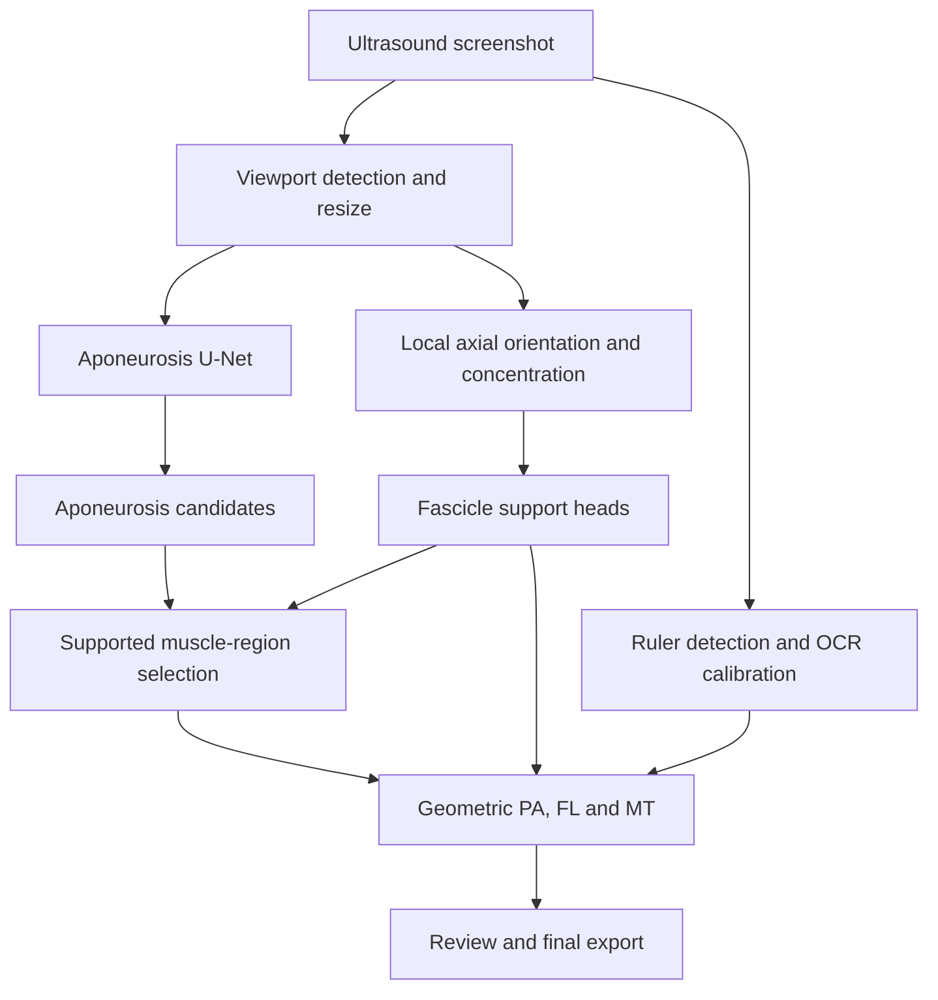

# UMUD Muscle Architecture from Ultrasound

A computer vision and geometry project by Isaac Wadhwani for the UMUD muscle architecture challenge. The pipeline detects aponeuroses, estimates a local fascicle orientation field, selects a supported muscle region, calibrates screenshot pixels to physical units, and estimates:

- Pennation angle (PA), in degrees
- Fascicle length (FL), in millimetres
- Muscle thickness (MT), in millimetres

The final submitted predictions cover **309 test scans**. The public leaderboard score reported during the competition was **0.67556**, compared with the reported DLTrack benchmark of **0.67944** (lower is better). These are recorded competition results, not a fresh evaluation or a verified private leaderboard result.

## What is included

This repository preserves the final prediction CSV, weighted-PA audit, verified-ruler submission, complete local V8 inference dependency chain, and four full-precision inference checkpoints. Python scripts provide commands for inspecting results and running the saved V8 pipeline.

**Reproducibility boundary:** the final weighted-PA and review patches were applied through interactive cells during the competition. Their exact executable cells were not recovered from the saved local notebooks. The final CSV and PA audit are preserved, and the export can be rebuilt from saved values, but the local V8 source alone does not reproduce the final submission end to end. The single-image runner is explicitly labeled as the preserved local V8 workflow. See [reproducibility notes](docs/REPRODUCIBILITY.md).

## Approach



The orientation model predicts doubled-angle vectors so opposite directions along the same fascicle represent the same axis. Its concentration output and a learned fascicle-support head weight the geometric evidence. The manual-support head is used for region selection; the expanded-support head supplies FL measurement weights.

FL uses dense straight fascicle fits and a weighted median, with terminal aponeurosis extension at 75% of the fitted terminal slope. Local orientation variation contributes to each fit; this is not curved-fascicle arc-length tracing. The final PA update used support/concentration weighting both within local orientation neighborhoods and across PA samples. The exact final sampler implementation is not present in this code snapshot.

## Start with the saved results

Python 3.11 or 3.12 is recommended. These commands need only Python's standard library:

```bash
python scripts/inspect_results.py
python scripts/rebuild_final_export.py
```

The first validates all 309 rows and reports measurement ranges. The second combines the verified-ruler predictions, saved weighted PA values, and the saved FL/MT corrections into a new export under `outputs/`. It checks agreement with the final archived predictions. It replays saved values; it does not recompute the model predictions.

## Run the preserved V8 inference workflow

Create and activate an environment:

```bash
python -m venv .venv
```

Activate with `.venv\Scripts\activate` on Windows, or `source .venv/bin/activate` on macOS/Linux. Then:

```bash
python -m pip install -r requirements.txt
python scripts/run_v8.py --check-models
python scripts/run_v8.py --image /path/to/ultrasound_image.tif
```

The check loads all four models and the pipeline without performing inference. Inference defaults to CPU; pass `--device cuda` when a compatible PyTorch/CUDA installation is available. Use `--depth-mm 40` only when the screenshot's full ruler depth has been manually verified as 40 mm. Outputs contain calibration status, OCR text, selected pair, and V8 measurements. Review incomplete calibration and anatomy before using physical measurements.

Competition image data are not bundled. Obtain the original images through your authorized competition/dataset access; see [data and model notes](docs/DATA_AND_MODELS.md). OCR's packaged detector/recognizer models may be initialized on the first inference run.

## Repository guide

| File or folder | Purpose |
| --- | --- |
| `results/final_submission.csv` | Exact archived final submission |
| `results/weighted_pa_audit.csv` | Per-image weighted PA, sample diagnostics, and selected pair |
| `results/verified_rulers_submission.csv` | Reviewed calibration submission preceding final PA/pair update |
| `results/final_export_adjustments.csv` | Saved FL/MT differences required to replay final export |
| `results/initial_calibration_audit.csv` | Earlier calibration audit; not the final corrected scale manifest |
| `results/region_selection_review.csv` | Saved region-selection review |
| `scripts/inspect_results.py` | Standard-library final CSV validation |
| `scripts/rebuild_final_export.py` | Replay saved final adjustments and verify numerical agreement |
| `scripts/run_v8.py` | Load models and run preserved local V8 inference |
| `src/test_set_inference_pipeline_v8.py` | Local OCR-calibrated inference wrapper |
| `src/test_set_inference_pipeline_v7.py` | Supported region selection and dense measurement wrapper |
| `src/test_set_inference_pipeline_v5.py` | Model inference, anatomy extraction, and support integration |
| `src/aponeurosis_model_v2.py` | Aponeurosis model architecture |
| `src/fascicle_orientation_unet.py` | Orientation/concentration model architecture |
| `src/aponeurosis_region_selection_v3.py` | Candidate region scoring |
| `src/muscle_geometry_measurements_v1.py` through `v5.py` | Measurement dependency chain used by V8 |
| `src/ultrasound_calibration_v2.py` and `v3.py` | Ruler candidates and labeled-depth calibration |
| `models/` | Inference-only weight parts, provenance, and checksums |
| `docs/` | Final review decisions, limitations, and verification |

Some earlier numbered modules remain because the final pipeline imports them. Their inclusion reflects an actual dependency rather than an invitation to choose arbitrary versions.

## Lessons and limitations

Calibration was a major source of error: tick detection alone did not establish whether gaps represented 5 or 10 mm, OCR depth labels needed correct ruler endpoints, and cropped/flipped screenshots required review. The final reviewed workflow assumed square pixels; anisotropic resizing remains an unresolved source of measurement error.

Many fascicles leave the visible field of view, making FL sensitive to extrapolated boundary slopes and orientation errors. Region selection can mistake a bright fascicle for an aponeurosis; one reviewed image, `IMG_00293.png`, was manually changed from pair `0-1` to `0-2`. The submission included manual calibration and anatomy review and should not be presented as a fully automatic result.

Other public submissions were used as diagnostic comparisons during error analysis. They are not treated as ground truth, and their prediction files are not included here. No competitor code is included in this package.

This is a research/competition project, not a clinically validated measurement tool. A fuller project report is planned. Dataset and third-party model rights remain with their respective providers; no blanket software or data license is granted by this repository.
